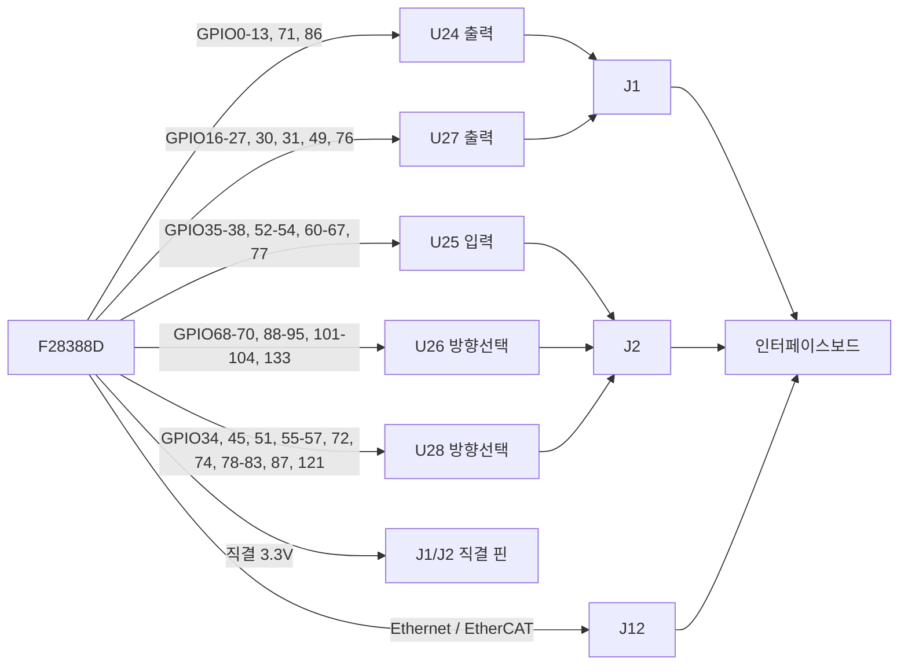

# PEETS Standard V3 Board I/O Reference

기준 자료 (2026-11-11 기준):

- 컨트롤보드 PCB: `Altium/388D_Control_v1/388D_Control_v2_PCB1.PcbDoc`
- 인터페이스보드 PCB: `Altium/388D_Interface/Inverter_Interface_v3.PcbDoc`
- 핀 기능: `CPU1/include_editable/pinmux.h`, `CPU1/source_editable/main_cpu1.c`, `CPU1/source_editable/easy28x_driverlib_v12.2.c`

## 개요

- 이 문서는 **현재 보드 세트(컨트롤보드 + 인터페이스보드)의 실제 배선**과 V3 코드의 핀 사용을 한곳에 정리한 레퍼런스다.
- 배선 정보는 PCB 파일의 pad-net 연결을 직접 추적한 결과다.
- SysConfig(`pinmux.h`)와 실제 배선·코드가 다르면 이 문서의 "알려진 불일치" 절에 적는다.
- 핀을 새로 쓰기 전에 "여유 GPIO" 절과 버퍼 방향을 먼저 확인한다.
- 범위 표기는 `35–38`처럼 en dash를 쓴다.

## 보드 구성

| 보드 | 커넥터 | 상대 커넥터 | 용도 |
| --- | --- | --- | --- |
| 컨트롤보드 | J1 (BergStak 100p) | 인터페이스 J4 | EPWM, 범용 출력, ADC, I2C |
| 컨트롤보드 | J2 (BergStak 100p) | 인터페이스 J5 | 버퍼 GPIO, INPUTXBAR, UART/SCI |
| 컨트롤보드 | J12 (BergStak 100p) | 인터페이스 J8 | Ethernet / EtherCAT 신호 |
| 컨트롤보드 | J9 (2x5, 2.54mm) | - | CPU1 SCI 헤더 (easyDSP) |
| 컨트롤보드 | J10 (2x5, 2.54mm) | - | CPU2 SCI 헤더 (easyDSP) |
| 컨트롤보드 | J11 (2x7, 2.54mm) | - | JTAG |
| 인터페이스보드 | PWM1A–PWM4B (RF) | - | EPWM1–4 A/B 출력 |
| 인터페이스보드 | J15 (2x5, 1.27mm) | - | Vout±, IL 센싱 입력 |
| 인터페이스보드 | DAC1–DAC3 | - | DAC 출력 모니터 |
| 인터페이스보드 | J11, J13 (16p 소켓) | - | ESP32-C5 DevKit |
| 인터페이스보드 | J1 (4p) | - | 전원 입력 (+15V, -15V, 5V, GND) |

## 제어 출력: EPWM

- GPIO0–13은 U24, GPIO16–23은 U27을 거쳐 5V 레벨로 J1에 나간다. 둘 다 출력 전용 버퍼다.
- **GPIO14/15는 EPWM8로 쓰지 않는다.** easyDSP CPU2용 SCI-B 핀이다. 따라서 EPWM8은 보드 밖으로 나가는 핀이 없다.
- 인터페이스보드에 커넥터가 있는 채널은 **EPWM1–4 뿐**이다. 각 출력에 GND 풀다운(R87–R94)이 있다.

| GPIO | 신호 | 버퍼 | 컨트롤보드 핀 | 인터페이스보드 |
| --- | --- | --- | --- | --- |
| GPIO0 | EPWM1A | U24 | J1.9 | PWM1A |
| GPIO1 | EPWM1B | U24 | J1.11 | PWM1B |
| GPIO2 | EPWM2A | U24 | J1.13 | PWM2A |
| GPIO3 | EPWM2B | U24 | J1.15 | PWM2B |
| GPIO4 | EPWM3A | U24 | J1.14 | PWM3A |
| GPIO5 | EPWM3B | U24 | J1.16 | PWM3B |
| GPIO6 | EPWM4A | U24 | J1.18 | PWM4A |
| GPIO7 | EPWM4B | U24 | J1.20 | PWM4B |
| GPIO8 | EPWM5A | U24 | J1.19 | 연결 없음 |
| GPIO9 | EPWM5B | U24 | J1.21 | 연결 없음 |
| GPIO10 | EPWM6A | U24 | J1.23 | 연결 없음 |
| GPIO11 | EPWM6B | U24 | J1.25 | 연결 없음 |
| GPIO12 | EPWM7A | U24 | J1.24 | 연결 없음 |
| GPIO13 | EPWM7B | U24 | J1.26 | 연결 없음 |
| GPIO16 | EPWM9A | U27 | J1.29 | 연결 없음 |
| GPIO17 | EPWM9B | U27 | J1.31 | 연결 없음 |
| GPIO18 | EPWM10A | U27 | J1.33 | 연결 없음 |
| GPIO19 | EPWM10B | U27 | J1.35 | 연결 없음 |
| GPIO20 | EPWM11A | U27 | J1.34 | 연결 없음 |
| GPIO21 | EPWM11B | U27 | J1.36 | 연결 없음 |
| GPIO22 | EPWM12A | U27 | J1.38 | 연결 없음 |
| GPIO23 | EPWM12B | U27 | J1.40 | 연결 없음 |

- GPIO0–13의 B측에는 테스트포인트 TP15–TP28, GPIO16–23에는 TP30–TP38이 있다.

## 통신 인터페이스

| 기능 | 코어 | GPIO | 경로 | 상태 |
| --- | --- | --- | --- | --- |
| easyDSP SCI-A | CPU1 | GPIO28 RX / GPIO29 TX | 직결 → J9.1 / J9.3, J2.3 / J1.96 | 사용 중. 핀 고정 (easyDSP 매뉴얼) |
| easyDSP SCI-B | CPU2 | GPIO15 RX / GPIO14 TX | 직결 → J10.1 / J10.3, J2.7 / J2.5 | 핀 설정됨. CPU2 커널은 아직 미호출 |
| UARTA | CM | GPIO85 RX / GPIO84 TX | 직결 → J2.99 / J2.97, J2.96 (CM_RX) / J2.98 (BOOT_2/CM_TX) | GPIO84는 boot 모드 핀 겸용 |
| SCI-D (ESP32) | CPU1 | GPIO142 RX / GPIO143 TX | J12.24 / J12.23 → 인터페이스 R86 / R85 → J13.5 / J13.4 | 배선 완료. pinmux 미반영 |
| I2CA | CPU1 | GPIO32 SDA / GPIO33 SCL | 직결 → J1.93 / J1.95 | 인터페이스보드 연결 없음 |
| MCAN | CPU1 | GPIO36 RX | U25(입력) → J2.24 | 인터페이스보드 연결 없음 |

- easyDSP 핀 설정은 `easyDSP_SCI_Init()`(CPU1)이 한다.
  - `F2838xD_CPU1_CPU2 = 1` 설정이라 CPU1이 GPIO14/15도 SCI-B로 잡고 소유권을 CPU2에 넘긴다.
  - 이 설정이 `GPIO_setPinMuxConfig()`의 EPWM8 / SCIA(34/49) 설정을 런타임에 덮어쓴다.
- `main_cpu1.c`는 easyDSP 초기화 전에 GPIO34/49를 일반 GPIO로 되돌린다. 구 보드의 SCI-A 핀이라 RX가 이중으로 잡히는 것을 막기 위해서다.
- GPIO31은 LED1으로 쓴다. 따라서 **MCAN TX는 현재 쓸 수 없다.** MCAN을 쓰려면 TX 핀을 따로 정해야 한다.
- SCI-B를 GPIO71/86으로 잡는 pinmux 설정은 쓰지 않는다. GPIO71이 출력 전용 버퍼(U24)를 거쳐서 수신이 불가능하다.

## 디버그 / 부트 / 상태 표시

| 항목 | 연결 | 비고 |
| --- | --- | --- |
| J9 | 1 = CPU1_RX(GPIO28), 3 = CPU1_TX(GPIO29), 4 = 3V3, 5 = BOOT_1(GPIO72), 9 = XRSn, 2/10 = GND | easyDSP CPU1 / ROM SCI 부트 |
| J10 | 1 = CPU2_RX(GPIO15), 3 = CPU2_TX(GPIO14), 4 = 3V3, 2/10 = GND | easyDSP CPU2 |
| J11 | TMS, TRSTn, TDI, TDO, TCK | JTAG 14핀 |
| S3 | XRSn ↔ GND | 리셋 버튼 |
| S4 | GPIO84(BOOT_2), GPIO72(BOOT_1) | 부트 모드 스위치. 두 핀 모두 3.3V 풀업 |
| D3 (LED1) | GPIO31 → U2 오픈드레인 | active-low. heartbeat / 명령 / fault 표시 |
| D4 | GPIO29 → U2 오픈드레인 | SCI-A TX 활동 표시 |
| GPIO107 | 전원감시 TPS3702(U6, U7) 출력, 풀업 R71, TP7 | CPU1이 입력으로 읽음. U26 1DIR 겸용 |
| ERRORSTS | J2.90, TP5 | MCU 에러 상태 출력 |
| XRSn | J9.9, J2.22, TP6 | 외부 리셋 |

## 버퍼 제어 GPIO

- U24, U25, U26, U27, U28은 16비트 dual-supply 트랜시버다(SN74xx16T245 계열).
  - A측(MCU 쪽)은 3.3V, B측(보드 커넥터 쪽)은 `IN_5V0`(5V)이다.
  - 신호 경로: `MCU_GPIOx` → 버퍼 → `bMCU_GPIOx` → BergStak J1/J2
- 방향은 bank(8핀) 단위로만 바뀐다.
  - bank1 = 1A1–1A8, 1DIR, 1OE
  - bank2 = 2A1–2A8, 2DIR, 2OE

### Buffer OE

- OE는 active-low다. low일 때 출력이 활성화된다.
- 각 버퍼의 1OE와 2OE는 같은 GPIO 하나에 묶여 있다.
- 현재 `main_cpu1.c`는 OE 5개를 함께 켜고 끈다. 출력이 꺼진 동안에는 입력 버퍼 U25도 꺼진다.

| GPIO | 버퍼 | 비고 |
| --- | --- | --- |
| GPIO42 | U24 | EPWM1–7 출력 버퍼 |
| GPIO43 | U27 | EPWM9–12 + 범용 출력 버퍼 |
| GPIO46 | U25 | 입력 버퍼. INPUTXBAR1–8 포함 |
| GPIO50 | U28 | 방향 선택 버퍼 |
| GPIO100 | U26 | 방향 선택 버퍼 |

### Buffer DIR

| 버퍼 | bank1 DIR | bank2 DIR | 결과 방향 |
| --- | --- | --- | --- |
| U24 | 3V3 고정 | 3V3 고정 | 출력 전용 (MCU → 보드) |
| U25 | GND 고정 | GND 고정 | 입력 전용 (보드 → MCU) |
| U26 | GPIO107 | GPIO120 | bank1은 전원감시 IC(TPS3702) 출력이 결정한다 |
| U27 | 3V3 고정 | 3V3 고정 | 출력 전용 (MCU → 보드) |
| U28 | GPIO58 | GPIO59 | bank 단위로 선택 |

- DIR = high이면 A → B(출력), DIR = low이면 B → A(입력)이다.
- `main_cpu1.c`는 GPIO58, GPIO59, GPIO120을 high(MCU → 보드)로 초기화한다.
- GPIO107은 U26 1DIR이면서 TPS3702 open-drain 출력(풀업 R71)이다.
  - CPU1 코드는 이 핀을 입력(전원감시 상태)으로만 읽는다.
  - 출력으로 구동하면 감시 IC와 충돌하므로 금지한다.
  - 전원이 정상이면 high가 되므로 U26 bank1은 사실상 출력 전용이다.

### Buffer-connected GPIO groups

| 버퍼 | bank | GPIO | 방향 |
| --- | --- | --- | --- |
| U24 | 1 | GPIO0, GPIO1, GPIO2, GPIO3, GPIO4, GPIO5, GPIO6, GPIO7 | 출력 |
| U24 | 2 | GPIO8, GPIO9, GPIO10, GPIO11, GPIO12, GPIO13, GPIO86, GPIO71 | 출력 |
| U25 | 1 | GPIO35, GPIO36, GPIO77, GPIO37, GPIO38, GPIO60, GPIO61, GPIO62 | 입력 |
| U25 | 2 | GPIO63, GPIO64, GPIO65, GPIO66, GPIO67, GPIO54, GPIO52, GPIO53 | 입력 |
| U26 | 1 | GPIO88, GPIO89, GPIO90, GPIO91, GPIO92, GPIO93, GPIO94, GPIO133 | DIR = GPIO107 (전원감시) |
| U26 | 2 | GPIO68, GPIO69, GPIO70, GPIO95, GPIO101, GPIO102, GPIO103, GPIO104 | DIR = GPIO120 |
| U27 | 1 | GPIO16, GPIO17, GPIO18, GPIO19, GPIO20, GPIO21, GPIO22, GPIO23 | 출력 |
| U27 | 2 | GPIO24, GPIO25, GPIO26, GPIO27, GPIO49, GPIO76, GPIO30, GPIO31 | 출력 |
| U28 | 1 | GPIO72, GPIO121, GPIO74, GPIO56, GPIO45, GPIO55, GPIO78, GPIO79 | DIR = GPIO58 |
| U28 | 2 | GPIO80, GPIO81, GPIO82, GPIO83, GPIO34, GPIO57, GPIO51, GPIO87 | DIR = GPIO59 |

- 각 bank의 GPIO 순서는 A1–A8 순서다.
- GPIO72는 boot 모드 핀(S4)이므로 일반 GPIO로 쓰지 않는다.
- GPIO61, GPIO64, GPIO66, GPIO70, GPIO72는 MCU와 버퍼 사이에 39Ω 직렬저항(R4–R8)이 있다. GPIO59(DIR)에는 R3이 있다.

### 버퍼를 거치지 않는 GPIO (직결, 3.3V)

| GPIO | 연결 | 비고 |
| --- | --- | --- |
| GPIO14, GPIO15 | J2.5, J2.7 + J10 (CPU2 SCI 헤더) | easyDSP CPU2 SCI-B |
| GPIO28, GPIO29 | J2.3, J1.96 + J9 (CPU1 SCI 헤더) | easyDSP CPU1 SCI-A. GPIO29는 LED 드라이버 U2에도 연결 |
| GPIO32, GPIO33 | J1.93, J1.95 | I2CA |
| GPIO39 | J2.6, J2.100 | 범용 |
| GPIO40 | J2.8 | 범용 |
| GPIO84, GPIO85 | J2.97, J2.99 | CM UARTA. GPIO84는 boot 모드 핀(S4) |
| GPIO96, GPIO97, GPIO98, GPIO99 | J1.3, J1.6, J1.5, J1.8 | 범용 |
| GPIO41, 44, 47, 48, 73, 75, 105–119, 122–132, 134–168 | J12 | Ethernet / EtherCAT 신호 |

## INPUTXBAR (보호 입력)

- GPIO60–67은 입력 전용 버퍼 U25를 거쳐 들어온다(5V 입력 → 3.3V).
- **현재 인터페이스보드에는 이 8개 핀에 연결된 회로가 없다.** 보호 신호를 쓰려면 인터페이스보드에 배선을 추가해야 한다.
- U25 OE(GPIO46)가 꺼져 있으면 MCU 쪽 입력이 떠 있게 된다. 보호 입력을 쓸 때는 PWM 출력 enable과 별개로 GPIO46을 먼저 켜야 한다.

| GPIO | INPUTXBAR | 컨트롤보드 핀 |
| --- | --- | --- |
| GPIO60 | INPUTXBAR1 | J2.28 |
| GPIO61 | INPUTXBAR2 | J2.29 |
| GPIO62 | INPUTXBAR3 | J2.30 |
| GPIO63 | INPUTXBAR4 | J2.31 |
| GPIO64 | INPUTXBAR5 | J2.32 |
| GPIO65 | INPUTXBAR6 | J2.33 |
| GPIO66 | INPUTXBAR7 | J2.34 |
| GPIO67 | INPUTXBAR8 | J2.35 |

## 아날로그

### 인터페이스보드가 쓰는 채널

| 신호 | 인터페이스 회로 | 컨트롤보드 핀 | MCU 입력 |
| --- | --- | --- | --- |
| Vout± (J15.4 / J15.2) | 차동 앰프 U9 → 테스트포인트 ADC(A2) | J1.61 | ADCINA2 |
| IL_SENS (J15.8) | 앰프 U8 (2단) → 테스트포인트 ADC(B2) | J1.63 | ADCINB2 |
| DAC1 커넥터 | R1/C1 필터 | J1.60 | ADCINA0 = DACOUTA |
| DAC2 커넥터 | R2/C2 필터 | J1.58 | ADCINA1 = DACOUTB |
| DAC3 커넥터 | R3/C3 필터 | J1.66 | ADCINB1 = DACOUTC |

- 이 채널들은 `CPU1/source_editable/analog.c`가 구동한다(`g_analog`). 상세는 `docs/specs/005-fullbridge-adc-dac/`를 본다.
  - ADCINA2와 ADCINB2는 EPWM1 SOCA(CTR = 0)로 동시에 샘플링한다.
  - DACA/B/C는 DAC1/2/3 커넥터로 나간다.
- `main_cpu1.c`의 구 ADC 모니터(`CPU1_ADCMON_*`)는 ADCINA0을 읽는다. ADCINA0은 DACOUTA(DAC1 커넥터)와 같은 핀이라 꺼 두었다(`CPU1_ADCMON_ENABLE 0`).

### 컨트롤보드 ADC 커넥터 핀 (J1)

- 각 채널은 직렬저항(R10–R36)을 거쳐 MCU ADC 핀에 연결된다.

| J1 핀 | MCU 입력 | J1 핀 | MCU 입력 |
| --- | --- | --- | --- |
| J1.60 | ADCINA0 | J1.58 | ADCINA1 |
| J1.61 | ADCINA2 | J1.59 | ADCINA3 |
| J1.55 | ADCINA4 | J1.53 | ADCINA5 |
| J1.64 | ADCINB0 | J1.66 | ADCINB1 |
| J1.63 | ADCINB2 | J1.65 | ADCINB3 |
| J1.68 | ADCINB4 | J1.70 | ADCINB5 |
| J1.54 | ADCINC2 | J1.52 | ADCINC3 |
| J1.49 | ADCINC4 | J1.47 | ADCINC5 |
| J1.69 | ADCIND0 | J1.71 | ADCIND1 |
| J1.75 | ADCIND2 | J1.77 | ADCIND3 |
| J1.80 | ADCIND4 | J1.82 | ADCIND5 |
| J1.76 | ADCIN14 | J1.74 | ADCIN15 |
| J1.83 | HSEC_ADC-VREFHI | | |

## Ethernet / EtherCAT

- 아래 신호는 컨트롤보드 J12를 거쳐 인터페이스 J8까지 이어진다.
- **현재 인터페이스보드(Inverter_Interface_v3)에는 Ethernet PHY도 EtherCAT PHY도 없다.** 이 핀들은 J8에서 끝난다(GPIO142/143 제외).
- pinmux는 향후 PHY 보드를 위해 아래 기능을 유지한다. PHY 보드 배선 근거 없이 재할당하지 않는다.

| 기능 | GPIO | 비고 |
| --- | --- | --- |
| Ethernet MII 데이터/클럭 | GPIO44, 75, 109–118, 122–124 | pinmux + `cpu1_configure_ethernet_mii_pins()` |
| Ethernet MDIO | GPIO105, GPIO106 | |
| Ethernet 기타 | GPIO41 (REVMII_MDIO_RST), GPIO47/48 (PPS0/1), GPIO73 (RMII_CLK) | pinmux |
| PHY 제어 | GPIO108 (powerdown), GPIO119 (reset) | `main_cpu1.c`가 일반 GPIO 출력으로 사용 |
| EtherCAT | GPIO125–132, GPIO134–168 | pinmux `MyECAT1` |

## 여유 GPIO

- 아래 GPIO는 V3 pinmux와 코드에서 특정 기능이 없는 핀이다.
- **모두 인터페이스보드 커넥터에서 끝난다(연결된 회로 없음).** 쓰려면 인터페이스보드에 배선을 추가해야 한다.
- 버퍼를 거치는 핀은 해당 버퍼 OE가 켜져 있어야 보드 쪽에 신호가 나간다(또는 들어온다).

| 경로 | 방향 | GPIO → 컨트롤보드 핀 |
| --- | --- | --- |
| 직결 (3.3V) | 양방향 | GPIO39 → J2.6, J2.100 · GPIO40 → J2.8 · GPIO96 → J1.3 · GPIO97 → J1.6 · GPIO98 → J1.5 · GPIO99 → J1.8 |
| U27 | 출력 전용 | GPIO24 → J1.37 · GPIO25 → J1.39 · GPIO26 → J1.41 · GPIO27 → J1.43 · GPIO30 → J1.46 |
| U25 | 입력 전용 | GPIO35 → J2.23 · GPIO37 → J2.26 · GPIO38 → J2.27 · GPIO52 → J2.37 · GPIO53 → J2.38 · GPIO54 → J2.36 |
| U26 bank1 | 출력 전용 | GPIO88–94 → J2.71–77 · GPIO133 → J2.78 |
| U26 bank2 | bank 단위 선택 | GPIO68 → J2.79 · GPIO69 → J2.80 · GPIO70 → J2.81 · GPIO95 → J2.82 · GPIO101–104 → J2.83–86 |
| U28 bank1 | bank 단위 선택 | GPIO45 → J2.45 · GPIO55 → J2.46 · GPIO56 → J2.44 · GPIO74 → J2.43 · GPIO78 → J2.47 · GPIO79 → J2.48 · GPIO121 → J2.42 |
| U28 bank2 | bank 단위 선택 | GPIO51 → J2.55 · GPIO57 → J2.54 · GPIO80–83 → J2.49–52 · GPIO87 → J2.56 |

조건부 여유 핀:

| GPIO | 경로 | 조건 |
| --- | --- | --- |
| GPIO34 | U28 bank2 → J2.53 | pinmux는 SCIA_TX. `main_cpu1.c`가 일반 GPIO로 되돌림 |
| GPIO49 | U27 → J1.42 | pinmux는 SCIA_RX. `main_cpu1.c`가 일반 GPIO로 되돌림 |
| GPIO71, GPIO86 | U24 → J1.30, J1.28 | pinmux는 SCIB. 실제로 SCI-B는 GPIO14/15를 쓰므로 미사용 |
| GPIO76 | U27 → J1.44 | 출력 전용. 구 문서의 SCID_TX 예약 핀 |
| GPIO77 | U25 → J2.25 | 입력 전용. 구 문서의 SCID_RX 예약 핀 |

## 알려진 불일치

| 항목 | 현재 상태 | 처리 |
| --- | --- | --- |
| GPIO14/15 | `pinmux.h`는 EPWM8A/B. 실제로는 easyDSP CPU2 SCI-B | SysConfig 재생성 시 SCIB로 변경 |
| GPIO142/143 | `pinmux.h`는 EtherCAT(ESC_RX1_DATA3 / ESC_LED_LINK0_ACTIVE). 인터페이스보드는 ESP32용 SCI-D | ESP32 통신 코드 추가 시 SCID_RX / SCID_TX로 변경 |
| GPIO34/49 | `pinmux.h`는 SCIA. 코드에서 일반 GPIO로 해제 | SysConfig 재생성 시 GPIO로 변경 |
| GPIO71/86 | `pinmux.h`는 SCIB. 미사용 | SysConfig 재생성 시 GPIO로 변경 |
| GPIO31 | `pinmux.h`는 MCAN_TX. 코드는 LED1 | LED1 유지 |
| J2.53 / J5.53 | 컨트롤보드 네트는 `bMCU_GPIO34`, 인터페이스보드 네트 이름은 `bMCU_GPIO29` | 인터페이스보드 네트 이름 수정 필요 (연결 회로 없음) |
| ESP32 제어선 | `UART_build_sheet.md`의 ESP_RST(GPIO145), CTS(GPIO126), RTS(GPIO146)는 J8.25–27에서 끝남. ESP EN과 SPI 네트는 MCU와 연결 안 됨 | 인터페이스보드 수정 시 반영 |
| 버퍼 OE | 5개 OE를 한꺼번에 제어 → 출력 OFF 시 U25 입력도 꺼짐 | 보호 입력 이식 시 GPIO46 분리 |
